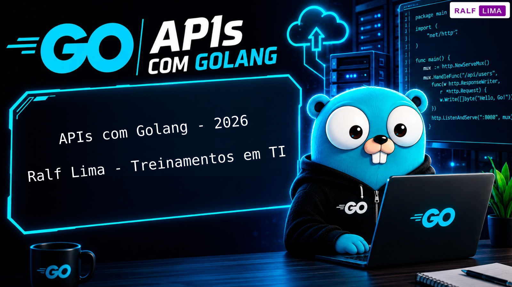

  
  
Instrutor: Ralf Schweder de Lima

  
  
  
   
   
  
Repositório destinado aos arquivos do curso de APIs com Golang (versão 1.26.4) do meu canal no YouTube, <a href="https://youtube.com/playlist?list=PLa145b-1y3o0&si=d6wIb3uXUTZ2a1a2" target="_blank">clique aqui</a> para acessar a playlist completa.

   
  

  <h3>Tópicos abordados:</h3>

   + Entender os conceitos sobre APIs; 
   + Criar e executar projeto; 
   + Implementar o servidor HTTP; 
   + Definir rotas e endpoints; 
   + Tipos de requisições; 
   + Configurar o Live Reload; 
   + Resolver o problema de CORS.

   <h3>Conteúdos extras, projeto final e certificado</h3>

   
Os membros do canal terão aulas extras e exclusivas, os conteúdos abordados serão:

   + Deploy da aplicação; 
   + Configurar o banco de dados PostgreSQL e reestruturar projeto; 
   + Trabalhar com variáveis de ambiente; 
   + Criar roteador (Mux).

   
Os membros também podem realizar um projeto para obter o certificado deste treinamento. Ao se tornar membro, você já pode realizar este projeto para obter o diploma.

   
Tendo dúvidas é só comentar nos vídeos ou enviar e-mail para: <b>contato@ralflima.com<b>.

  

